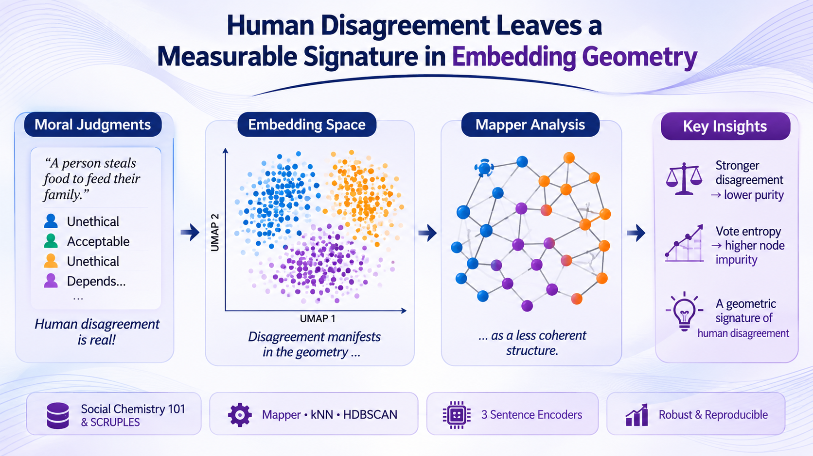

<p align="center">
  
</p>

<h1 align="center">When Moral Judgment Becomes Structurally Ambiguous</h1>

<p align="center">
  Human Disagreement Leaves a Signature in Sentence-Embedding Geometry
</p>
# Moral Disagreement in Embedding Geometry

**When Moral Judgment Becomes Structurally Ambiguous: Human Disagreement Leaves a Signature in Sentence-Embedding Geometry**

This repository contains the analysis code for studying whether **human disagreement is reflected in the structure of pretrained sentence-embedding spaces**.

The study uses Mapper-based structural analysis, chance-corrected component purity, edge agreement, node impurity, and non-topological controls to examine moral and social judgment data.

## Research question

> **Can human disagreement be detected from the geometry of a pretrained embedding space, before task-specific fine-tuning?**

Across two datasets and three frozen sentence encoders, stronger disagreement is associated with less label-coherent structure and greater local node impurity.

## What is included

- Mapper-based structural analysis
- Social Chemistry 101
- SCRUPLES
- Three frozen sentence encoders:
  - `all-MiniLM-L6-v2`
  - `all-mpnet-base-v2`
  - `bge-small-en-v1.5`
- Multi-annotator disagreement analysis
- Agreement-tier analysis
- Chance-corrected metrics and label-shuffled null models
- Seed-level replication
- Text-field ablation
- Mapper parameter sensitivity analysis
- kNN and HDBSCAN controls
- Bayesian follow-up analysis

## Analysis pipeline

```text
Human judgments
      ↓
Text
      ↓
Frozen sentence embeddings
      ↓
Lens construction
      ↓
Mapper graph
      ↓
Structural metrics
      ↓
Label-shuffled null model
      ↓
Disagreement–structure analysis
```

The implementation keeps the embedding space, lens, clustering, and structural evaluation as separate stages. This allows the structural signal to be compared with simpler neighborhood and density-based methods.

## Main findings

The main analysis reports:

- lower chance-corrected component purity for strongly disagreeing items;
- a positive association between vote entropy and local node impurity;
- consistent direction across the three frozen encoders;
- replication across Social Chemistry 101 and SCRUPLES;
- recovery of the disagreement-related pattern with kNN and HDBSCAN controls.

The intended methodological interpretation is **geometric rather than uniquely topological**: Mapper provides an interpretable graph-based view of the embedding geometry, while the underlying disagreement-related pattern is also recovered by simpler methods.

## Repository structure

```text
moral-disagreement-embedding-geometry/
├── README.md
├── CITATION.cff
├── LICENSE
├── requirements.txt
├── .gitignore
├── notebooks/
│   ├── 01_main_analysis.ipynb
│   └── 02_bayesian_followup.ipynb
└── results/
    └── README.md
```

## Getting started

The notebooks are designed to run in **Google Colab** or a compatible Python environment.

### 1. Install dependencies

```bash
pip install -r requirements.txt
```

### 2. Run the main analysis

Open:

`notebooks/01_main_analysis.ipynb`

Run the notebook from top to bottom.

The main notebook downloads/loads the required datasets and sentence encoders, runs the structural analyses, and creates a `final_results/` directory containing tables, figures, and the final report. It also creates:

```text
final_results.zip
```

### 3. Run the Bayesian follow-up

Open:

`notebooks/02_bayesian_followup.ipynb`

The notebook expects the `final_results.zip` produced by the main analysis. In Google Colab, it can be uploaded when prompted.

## Data

The repository does **not** redistribute the source datasets.

The analysis uses Social Chemistry 101 and SCRUPLES. The notebooks contain the loading procedures used in the study.

Please follow the original dataset licenses and terms when using the data.

## Reproducibility

The analysis uses fixed seeds, predefined decision rules, graph-specific label-shuffled null models, multiple encoders, and repeated sampling. The Bayesian follow-up treats the independent resampling seeds as the unit of analysis.

For the full experimental scope and definitions, please see the associated paper.

## Citation

If you use this code or build on this analysis, please cite:

**Mohammad Pedrami and Yasaman Saffari.**  
*When Moral Judgment Becomes Structurally Ambiguous: Human Disagreement Leaves a Signature in Sentence-Embedding Geometry.*

The paper is currently under review/submission. Citation metadata will be updated when the publication information becomes available.

## Authors

**Mohammad Pedrami** — University of Tehran  
**Yasaman Saffari** — University of Kashan

Contributions and extensions of the analysis are welcome.
